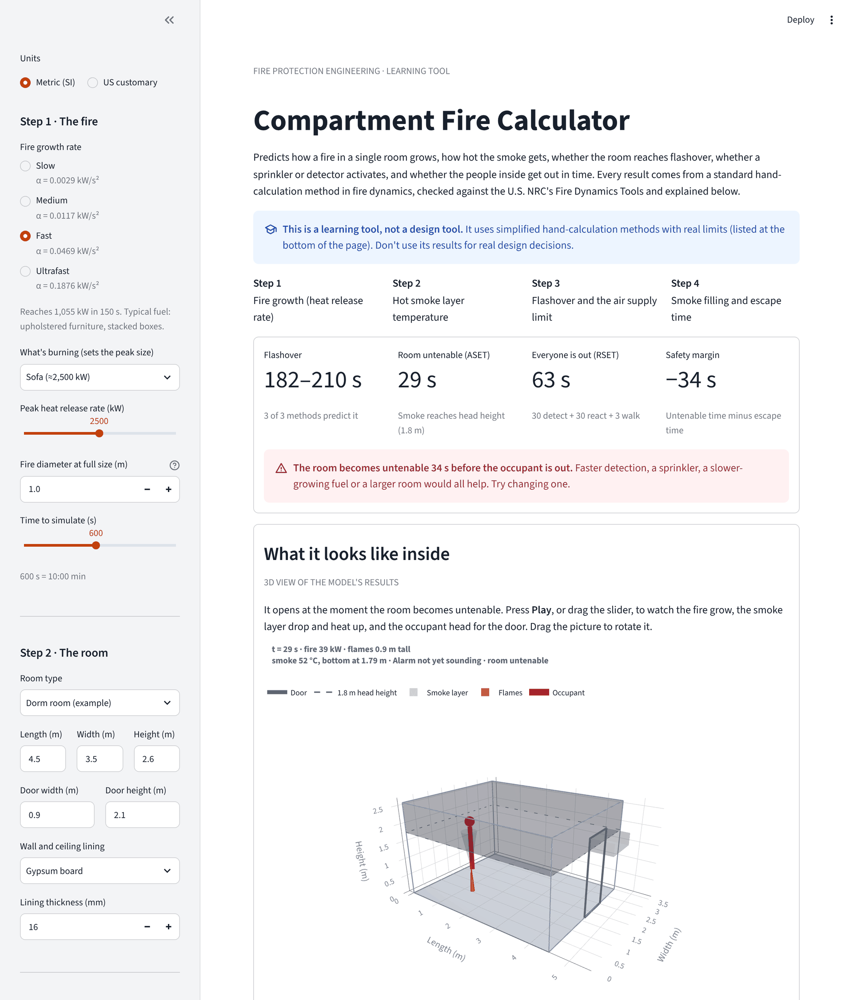

# Compartment Fire Calculator

> **This is a learning tool, not a design tool.** It uses simplified hand-calculation
> methods with real limits (listed below). Don't use its results for real design decisions.

An interactive web app that predicts how a fire in one room grows, how hot the smoke
gets, whether the room flashes over, whether a sprinkler or heat detector activates, and
whether the people inside get out before conditions become untenable. Every result comes
from a standard hand-calculation method in fire dynamics, the app shows each calculation
with the numbers substituted in, and the methods are checked against the U.S. NRC's
Fire Dynamics Tools (NUREG-1805).

A first-year fire protection engineering project by **Dhruv Sirigiri**
(B.S. Fire Protection Engineering, University of Maryland).

[](https://compartment-fire-calculator.streamlit.app/)

**Live app: https://compartment-fire-calculator.streamlit.app/**



## What it does

You describe a fire, a room, its fire protection and the people in it, in metric or US
customary units. The app works through four steps:

| Step | Question | Method |
|---|---|---|
| 1 | How big is the fire? | t-squared fire growth (NFPA 72) |
| 2 | How hot does the smoke get? | MQH hot gas layer correlation |
| 3 | Does the room flash over? | Babrauskas, Thomas and MQH flashover methods; air supply (ventilation) limit |
| 4 | Do people get out in time? | Two-zone smoke filling (Heskestad plume); ASET vs RSET |
| + | Does a sprinkler or heat detector activate? | Alpert ceiling jet and RTI heating (DETACT-QS) |

It then shows:

- **A verdict**: the flashover time range, when the room becomes untenable (ASET), when
  everyone is out (RSET), and the safety margin between them. With a sprinkler, also its
  activation time and what it changed (flashover and smoke temperature with and without it).
- **A 3D view of the room** you can play like a video: the smoke layer dropping and
  heating up, flames at Heskestad's flame height, smoke spilling out of the door, the
  sprinkler spraying once it activates, and the occupant walking to the door. It draws the
  model's results; it is not a 3D fire simulation (that would need CFD software such as
  NIST's FDS).
- **Interactive charts** of fire size, smoke and device temperatures, and smoke layer
  height, the flashover methods table, and the numbers behind every chart.
- **"Check the calculation by hand"**: every equation at a moment you choose, with the
  scenario's numbers substituted in, so each line can be redone with a calculator.
- **The NUREG-1805 validation table**, an explanation of every method, and an honest
  section on how realistic the results are.

## The methods

Ambient temperature $T_a$ = 20 °C. The physics is in SI units throughout (kW, m, s, kg),
as the correlations were written; with US customary units selected, the app converts
inputs to SI and results back (1 ft = 0.3048 m, 1 Btu = 1.05505585 kJ).

### Step 1: Fire growth (t-squared fire)

```math
Q(t) = \alpha t^2 \qquad \alpha = \frac{1055}{t_g^2}
```

The fire grows until it reaches the peak heat release rate of the fuel; there is no
decay phase. Growth classes from NFPA 72, Annex B, defined by the time $t_g$ to reach
1055 kW (1000 Btu/s):

| Growth | $t_g$ (s) | α (kW/s²) |
|---|---:|---:|
| Slow | 600 | 0.0029 |
| Medium | 300 | 0.0117 |
| Fast | 150 | 0.0469 |
| Ultrafast | 75 | 0.1876 |

### Step 2: Hot gas layer temperature (MQH)

McCaffrey, Quintiere and Harkleroad (1981):

```math
\Delta T_g = 6.85 \left[ \frac{Q^2}{A_o\sqrt{H_o}\; h_k\, A_T} \right]^{1/3}
```

- $A_o\sqrt{H_o}$ is the opening factor (door area × √door height).
- $A_T = 2(LW + LH + WH) - A_o$ is the interior surface area minus the opening.
- $h_k$ is the wall's effective heat transfer coefficient. It depends on the thermal
  penetration time $t_p$:

```math
t_p = \frac{\rho c}{k}\left(\frac{\delta}{2}\right)^2 \qquad
h_k = \begin{cases} \sqrt{k \rho c / t} & t < t_p \\ k/\delta & t \ge t_p \end{cases}
```

The correlation was fitted to layer temperatures below about 600 °C, so the app shows
results above that as outside its range. Lining properties (NUREG-1805):

| Lining | k (kW/m·K) | ρ (kg/m³) | c (kJ/kg·K) | Default δ (mm) |
|---|---:|---:|---:|---:|
| Gypsum board | 0.00017 | 960 | 1.1 | 16 |
| Concrete | 0.0016 | 2400 | 0.75 | 150 |
| Brick | 0.0008 | 2600 | 0.8 | 100 |
| Plywood | 0.00012 | 540 | 2.5 | 13 |
| Fiber insulation board | 0.00053 | 240 | 1.25 | 25 |

### Step 3: Flashover and the air supply limit

Three estimates of the smallest fire that can cause flashover:

```math
\text{Babrauskas: } Q_{FO} = 750\, A_o\sqrt{H_o} \qquad
\text{Thomas: } Q_{FO} = 7.8\, A_T + 378\, A_o\sqrt{H_o}
```

```math
\text{MQH: } Q_{FO} = 610 \left( h_k\, A_T\, A_o\sqrt{H_o} \right)^{1/2}
```

The MQH method is applied as the time the Step 2 layer temperature reaches
$T_a$ + 500 °C. (Solving the MQH equation exactly for a 500 K rise gives a coefficient
of about 624 rather than the published 610, a 2% difference.)

The door also limits how big the fire can get. About $0.5\,A_o\sqrt{H_o}$ kg/s of air can
flow in, and burning 1 kg of air releases about 3000 kJ:

```math
Q_{vent} = 1500\, A_o\sqrt{H_o} \qquad Q_{eff}(t) = \min\left(\alpha t^2,\ Q_{max},\ Q_{vent}\right)
```

$Q_{eff}$ is the fire used in every step.

### Step 4: Smoke filling and escape (ASET vs RSET)

A two-zone model: a hot, well-mixed smoke layer under the ceiling and clear air below
it, with the boundary at height $z$. The plume (Heskestad, convective fraction 0.7, fire
at floor level) carries mass up into the layer, and once the layer is below the top of
the door ($H_d$), smoke flows out through the doorway:

```math
\dot m_p = 0.071\, Q_c^{1/3} z^{5/3} + 0.0018\, Q_c \qquad Q_c = 0.7\,Q
```

```math
\dot m_{out} = \tfrac{2}{3} C_d W \rho_g \sqrt{2 g \left(1 - \tfrac{T_a}{T_g}\right)\tfrac{T_g}{T_a}}\,(H_d - z)^{3/2} \qquad C_d = 0.7
```

```math
\frac{dm}{dt} = \dot m_p - \dot m_{out} \qquad \rho_g = \frac{353}{T_g} \qquad z = H - \frac{m}{\rho_g\, A_{floor}}
```

The layer temperature $T_g$ (in K) comes from Step 2. The equation is solved with the
explicit Euler method, $\Delta t$ = 0.25 s.

- **ASET** (available safe egress time) is the earlier of: the layer drops to 1.8 m
  (head height), or the layer reaches 200 °C.
- **RSET** (required safe egress time) = detection time + reaction (pre-movement) time
  + walking distance / walking speed.
- The design works only if ASET > RSET.

### Sprinklers and heat detectors

The plume spreads under the ceiling as a hot, fast ceiling jet. Alpert's correlations
give its temperature and velocity at a horizontal distance $r$ from the fire under a
ceiling $H$ above it (here $H$ is the room height):

```math
T_{jet} - T_a = \begin{cases} 16.9\, Q^{2/3}/H^{5/3} & r/H \le 0.18 \\ 5.38\,(Q/r)^{2/3}/H & r/H > 0.18 \end{cases}
\qquad
u_{jet} = \begin{cases} 0.96\,(Q/H)^{1/3} & r/H \le 0.15 \\ 0.195\, Q^{1/3} H^{1/2} / r^{5/6} & r/H > 0.15 \end{cases}
```

A sprinkler bulb or detector heats with a lag set by its Response Time Index (RTI) and
activates at its rated temperature:

```math
\frac{dT_d}{dt} = \frac{\sqrt{u_{jet}}}{RTI}\,(T_{jet} - T_d)
```

Because the fire grows, this is stepped forward every 0.25 s with the current fire size
(DETACT-QS). When a **sprinkler** activates, the fire stops growing and stays at its size
then (a common cautious design assumption). A **heat detector** can set the alarm time
instead of a smoke alarm. RTI values and temperature ratings come from the NUREG-1805
tables (Madrzykowski 1995 for sprinklers; NFPA 72 Table B-3.2.5.1 for heat detectors).

**Flame height** (3D view, and the check of where the flames reach) uses Heskestad's
correlation $L = 0.235\,Q^{2/5} - 1.02\,D$. The burning diameter grows with the fire,
$D = D_{full}\sqrt{Q/Q_{peak}}$: a t-squared fire is what flames spreading at a steady
speed over fuel with a fixed heat release per square metre produce, so its burning area
grows in proportion to $Q$.

## How it was checked

There are 153 automated tests (`pytest`).

**Against the U.S. NRC's Fire Dynamics Tools (NUREG-1805).** Each NRC spreadsheet comes
with a worked example; the model was run on the same inputs. **33 of 33 comparisons
agree** within their tolerance. Full table: [docs/VALIDATION.md](docs/VALIDATION.md).

| NUREG-1805 example | NRC | This model |
|---|---:|---:|
| Ch. 2.1 MQH temperature rise at 60 s (300 kW, concrete room) | 125.232 K | 125.232 K with the NRC's h_k; 125.377 K (+0.12%) with the model's own* |
| Ch. 13 Babrauskas / Thomas / MQH flashover HRR | 2612.72 / 5620.17 / 2740.12 kW | 2612.72 / 5620.17 / 2740.12 kW |
| Ch. 10 sprinkler activation (1000 kW, RTI 42, 100 °C, H = r = 3 m) | 73.67 s | 73.67 s exact formula; 73.50 s time-stepped |
| Ch. 10 heat detector activation (1000 kW, RTI 306, 53.3 °C, H = 4 m, r = 3 m) | 141.21 s | 141.21 s exact formula; 141.25 s time-stepped |
| Ch. 3 Heskestad flame height (D = 1.09 m, 3136 kW) | 4.77387 m | 4.77387 m |

\*The NRC rounds concrete's k·ρ·c to 2.9; 0.0016 × 2400 × 0.75 = 2.88. With 2.9 the
difference disappears. NUREG-1805 uses a different smoke-filling method, so Step 4's
smoke layer height is not part of this comparison.

**Against the original prototype.** The model reproduces every check value worked out
with the single-file prototype (`index.html`), agrees with it to about $10^{-13}$ at
every second of four scenarios, and the app displays the same values as the prototype
for all 90 numbers compared across six scenarios:

| Scenario | Quantity | Expected | Model |
|---|---|---|---|
| Bedroom | Thermal penetration time $t_p$ | ≈ 398 s | 397.6 s |
| Bedroom | Opening factor / $A_T$ | 2.546 / 81.4 m² | 2.5456 / 81.40 m² |
| Bedroom | $T_g$ at 150 s (1055 kW) | ≈ 388 °C | 388.2 °C |
| Bedroom | $T_g$ at 231 s (2500 kW) | ≈ 723 °C | 723.2 °C |
| Bedroom | $T_g$ at 150 s, 150 mm concrete | ≈ 252 °C | 251.8 °C |
| Bedroom | Babrauskas / Thomas / $Q_{vent}$ | 1909 / 1597 / 3818 kW | 1909.2 / 1597.2 / 3818.4 kW |
| Bedroom | MQH flashover time | 184 s | 184 s |
| Bedroom | Smoke layer reaches 1.8 m | 29 s | 29 s |
| Bedroom | $z$ at 60 / 120 / 300 s | ≈ 1.22 / 0.88 / 0.10 m | 1.216 / 0.877 / 0.100 m |
| Dorm | Babrauskas / Thomas / $Q_{vent}$ | 2054 / 1591 / 4108 kW | 2054.2 / 1590.7 / 4108.3 kW |
| Dorm | MQH flashover / 1.8 m | 182 s / 29 s | 182 s / 29 s |
| Living room | Flashover / 1.8 m / $z$ at 600 s | none / 86 s / ≈ 1.25 m | none / 86 s / 1.245 m |
| — | RSET, awake with an alarm | 63.3 s | 63.33 s |

Bedroom 5 × 4 × 2.4 m with a 0.9 × 2.0 m door; dorm 4.5 × 3.5 × 2.6 m with a 0.9 × 2.1 m
door (fast fire, 2500 kW sofa, 16 mm gypsum). Living room 7 × 6 × 2.4 m with a
1.8 × 2.1 m opening (slow fire, 750 kW chair). One original check value was corrected:
"150 mm concrete at 150 s ≈ 278 °C" is the result for concrete left at 16 mm thick; for
150 mm concrete the equation gives 252 °C.

**How realistic is it?** Matching the NRC shows the equations are coded correctly. How
close the correlations come to real fires is a separate question, studied by the NRC
against full-scale experiments in NUREG-1824. Read the results as engineering
estimates; the app's "Is this calculator realistic?" section explains why.

## Run it yourself

You need Python 3.10 or newer ([python.org](https://www.python.org/downloads/)).

```bash
git clone https://github.com/dhruvsirigiri/compartment-fire-calculator.git
cd compartment-fire-calculator
python3 -m venv .venv
source .venv/bin/activate        # Windows: .venv\Scripts\activate
pip install -r requirements.txt
streamlit run app.py             # opens http://localhost:8501
```

Run the tests with:

```bash
pytest
```

## Project structure

```
fire_model/          the physics, as pure functions (no user interface code), SI units
  growth.py          Step 1: t-squared fire growth, burning diameter
  room.py            room geometry: opening factor, A_T, floor area, input checks
  layer_temp.py      Step 2: MQH layer temperature, lining properties
  flashover.py       Step 3: flashover thresholds, air supply limit
  smoke_filling.py   Step 4: two-zone smoke filling (Euler method), Heskestad flame height
  egress.py          Step 4: ASET, RSET, occupant timeline
  detection.py       sprinklers and heat detectors: Alpert ceiling jet, RTI, DETACT-QS
  timeline.py        "first second at which something happens" helpers
  scenario.py        runs all the steps for one scenario
  validation.py      the NUREG-1805 comparisons (NRC inputs, answers and cells)
app.py               the Streamlit web app: inputs, verdict, page layout
charts.py            the 2D charts
room_view.py         the 3D room view
worked_example.py    "check the calculation by hand"
explanations.py      the explanatory text, validation and realism sections
units.py             metric / US customary conversions for display
tests/               pytest tests, including every check value and NRC example
docs/VALIDATION.md   the NUREG-1805 validation report
docs/nureg-1805/     copies of the NRC spreadsheets used
index.html           the original single-file prototype (reference implementation)
```

## Limitations

- One room with one opening. Smoke spreading to other rooms is not modeled.
- The fire sits on the floor and never decays or burns out.
- A sprinkler only stops the fire from growing; its water cooling the smoke and
  shrinking the fire is not modeled.
- Alpert's ceiling jet correlations are for a large flat ceiling. In a small room the
  hot layer makes the real ceiling jet hotter, so activation times here tend to be late
  (on the cautious side).
- The smoke layer has one average temperature, from MQH. MQH was fitted to tests below
  about 600 °C, and the smoke filling model uses it outside its original purpose.
- The door outflow ignores the neutral plane and the fresh air flowing in below it, so
  late-time layer heights near the floor are approximate. Once the room is full of smoke,
  the plume still delivers slightly more gas than the door removes, so the layer height
  jitters between about 0 and 0.1 m.
- Heskestad's plume equation is meant for heights above the flame tip; when the smoke
  layer is lower than the flames it is used outside that range (the app says when).
- Flame height depends on the fire diameter, which is an assumed input.
- Tenability uses layer height and temperature only (no toxic gases or visibility).
- The occupant walks straight to the door at a constant speed.

Real designs use full zone models such as CFAST, or CFD models such as FDS (both free
from NIST), together with safety factors.

## Ideas for later

1. Add the worked examples from the NUREG-1805 report volumes to the validation.
2. Smoke detector activation (NUREG-1805 Chapter 10 also covers it), so the alarm time
   can be calculated for smoke alarms too.
3. Fire decay phase and total fuel load.
4. Compare one scenario with NIST CFAST.
5. Export a one-page PDF report of a scenario.

## References

- NFPA 72, *National Fire Alarm and Signaling Code*, Annex B (t-squared fires) and
  Table B-3.2.5.1 (heat detector RTI, 1999 edition).
- McCaffrey, B. J., Quintiere, J. G. and Harkleroad, M. F., "Estimating Room
  Temperatures and the Likelihood of Flashover Using Fire Test Data Correlations,"
  *Fire Technology* 17 (1981).
- Babrauskas, V. (1980); Thomas, P. H. (1981): flashover correlations.
- Heskestad, G., plume and flame height, *SFPE Handbook of Fire Protection Engineering*.
- Alpert, R. L., "Calculation of Response Time of Ceiling-Mounted Fire Detectors,"
  *Fire Technology* 8 (1972).
- Madrzykowski, D., "Evaluation of Sprinkler Activation Prediction Methods,"
  ASIAFLAM '95 (1995): generic sprinkler RTI values.
- NFPA, *Automatic Sprinkler Systems Handbook*: sprinkler temperature ratings.
- U.S. Nuclear Regulatory Commission, NUREG-1805 Supplement 1, *Fire Dynamics Tools
  (FDTs)* (2013), and its spreadsheets (version 1805.1).
- U.S. Nuclear Regulatory Commission, NUREG-1824, *Verification and Validation of
  Selected Fire Models for Nuclear Power Plant Applications*.
- SFPE, *Engineering Guide to Human Behavior in Fire* (ASET/RSET framework).

Peak fire sizes, room presets, the default fire diameter and device distances are
rounded, generic examples.
